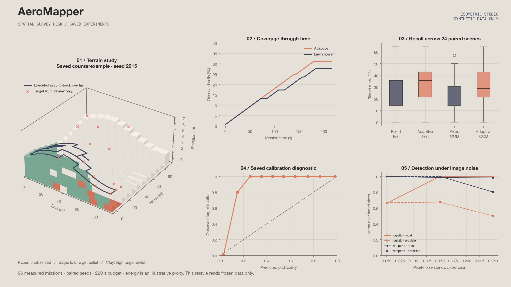
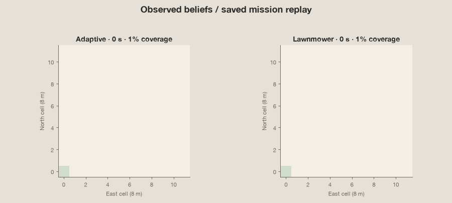

<div align="center">

# 🛸 AEROMAPPER AI 🛸
### 3D Aerial Survey Drone Simulation, Adaptive Perception & Path Planning Workbench

[](https://github.com/mirmoosa1014-rgb/aeromapper-ai/actions/workflows/ci.yml)
[](https://python.org)
[](https://react.dev)
[](https://typescriptlang.org)
[](#explore-the-laboratory)
[](https://github.com/TheRollerBlader/motion-graphic-style-library)
[](LICENSE)

</div>

---

# Problem Statement

**Can a single virtual drone discover more hidden targets by choosing its next viewpoint than by following a fixed coverage pattern?** AeroMapper AI makes that question inspectable: generate a world, observe synthetic camera patches, infer target probabilities, and compare two survey policies under the same time and energy limits.

Inputs are a seed-controlled 96 × 96 m terrain, a known no-fly map, synthetic target imagery, and a mission budget. Outputs are a collision-checked flight trace, detector beliefs, target findings, and measured coverage, recall, precision, distance, and runtime. The success criterion is higher target recall at matched budgets without violating constraints. All results below are **synthetic**; this project neither controls a drone nor establishes real-world detection or flight safety.



**AeroMapper AI** · Visual survey research workbench · Python + FastAPI + React + TypeScript

[Design system](docs/design.md) · [Architecture](docs/architecture.md) · [Model card](docs/model.md) · [Evaluation](docs/evaluation.md) · [90-second demo](docs/demo.md) · [Plain-language explanation](docs/explain.md)

## Explore the laboratory

- Drag the **3D terrain** to rotate the view. The actual terrain elevations, executed path, virtual camera footprint, target belief colors, and static obstacles share one coordinate system.
- Seek or play a **mission replay**. The camera panel shows the actual grayscale cell patch passed to the trained detector, rather than a decorative placeholder.
- Switch between **adaptive** and **lawnmower** policies, reveal hidden truth for review, and compare measured coverage, recall, and precision.
- Change the seed, budget, or scene family and run a new **paired experiment**. Export the current comparison as JSON, including replay imagery.
- Start with a saved **failure case**, so the demo does not imply that adaptive planning always wins.



The animation and hero figure are saved-output evidence restyled in **Isometric Studio**: warm paper, clay/sage survey blocks and indigo traces. The working interface is now a spatial survey desk with a compact mission strip, 3D world/camera workspace and lower inspection drawer. See the [design mapping, motion adaptations and verification procedure](docs/design.md).

The previous app screenshot files show the old dark interface. New desktop/mobile/reduced-motion screenshots are pending the supplied Linux browser workflow; local Mac browser launch is blocked by a sandbox permission. No new screenshot is fabricated.

## Measured results

The bounded experiment evaluates **24 held-out scenes per family × 2 policies × 2 families = 96 missions**, each with a 220 s time limit and an illustrative energy limit of 187 units. Both policies use the same hidden target placement, imagery seeds, detector, and obstacle map. Means and sample standard deviations are in [summary.json](results/summary.json); every mission is in [missions.csv](results/missions.csv).

| Scene family | Policy | Coverage | Target recall | Target precision |
| --- | --- | ---: | ---: | ---: |
| Held-out | Lawnmower | 24.86% | 25.89% | 95.14% |
| Held-out | Adaptive | 30.30% | 33.33% | 95.14% |
| OOD: noisier, denser obstacles, different terrain | Lawnmower | 22.71% | 24.40% | 9.90% |
| OOD: noisier, denser obstacles, different terrain | Adaptive | 29.20% | 32.14% | 10.23% |

The OOD precision collapse is a major failure, despite acceptable-looking recall: increased noise makes many empty patches look target-like. **The detector is unsuitable for real aerial use.** In the saved counterexample, seed **2015**, the adaptive policy covers more area yet finds **6/14 targets**, while lawnmower finds **8/14**. Local exploration misses a more target-rich part of the scene. See [evaluation](docs/evaluation.md) for assumptions and variability.

## Run locally

Python 3.11–3.14 and Node 24 are supported; Python 3.12/Node 24 were verified. No hardware, API key, GPU, cloud account, or external dataset is needed. Installation needs internet; the installed app and experiments then run offline.

```bash
./setup.sh
./run.sh
```

Open **http://127.0.0.1:8105**. The backend serves the production frontend and the API on loopback. A trained JSON model and a representative saved replay are already included.

For frontend development, run `npm run dev` in `frontend` while the backend runs on port 8105. The Vite development URL is http://127.0.0.1:5105.

```bash
# Core and in-process API checks
.venv/bin/python -m unittest discover -s tests -v

# Browser interactions and real screenshots (install Chromium once)
(cd frontend && npx playwright install chromium)
node scripts/design-check.mjs

# Quick: 16 paired missions; full: 96 paired missions
.venv/bin/python -m aeromapper.experiment --quick
.venv/bin/python -m aeromapper.experiment
.venv/bin/python -m aeromapper.figures

# Type-check + production build
(cd frontend && npm ci && npm run build)
```

The full experiment regenerates the demo, trained model, CSVs, and summary. Rebuild the frontend afterward to copy the new replay into production assets. Quick mode intentionally overwrites the same result paths; rerun the full mode before quoting this README's numbers. CLI jobs can be interrupted with Ctrl+C. Interactive missions are bounded; the UI can cancel waiting for a response, but that cancellation does not interrupt a request already executing on the server.

For a frozen Python install, replace `requirements.txt` with `requirements.lock` in the setup command. `frontend/package-lock.json` fixes the JavaScript dependency graph.

## What the prototype assumes

The camera is an orthographic footprint approximation at fixed 12 m above local terrain, with a 60° field of view. The footprint width is 13.86 m. The sensor samples cell centers conservatively; the 8 m grid currently gives one sampled cell per viewpoint. A 12 × 12 grayscale patch describes that cell, with texture, shadow, target size variation, distractors, noise, and visibility contrast attenuation. It is not a photorealistic full-frame image renderer.

Motion follows four-connected, obstacle-free grid routes with a rest-to-rest triangular speed profile. Each 8 m leg takes 4 s, reaches 4 m/s, and respects the 2 m/s² acceleration and 8 m/s speed bounds. Every accepted excursion reserves the exact path, time, and energy required to return to base, and the return is executed in the saved trace. Terrain is 2.5D context; vertical climb dynamics and vehicle extent are not simulated.

**Known limitations relative to the broader project brief:** static no-fly cells are known from the start, rather than discovered by online mapping. The adaptive planner is an explicit coverage-and-travel heuristic, not a learned planner. At the default one-cell footprint its uncertainty bonus is inactive, so nearest unobserved-cell ordering drives adaptation. Visibility is attenuated contrast, without a geometric occlusion engine. Scene families are deliberately small procedural domains. These choices keep the model transparent and bounded; they limit research claims.

## Verification and repository readiness

Twelve meaningful core/API checks cover camera geometry, coordinate mapping, deterministic observations/replay, missing-model fallback, split identity, matched worlds, collision-free routes, time/energy limits, return to base, and malformed requests. The TypeScript/Vite production build, a fresh pinned Python environment, and the quick/full experiments were run. The original interface passed real browser interactions before redesign. The redesigned TypeScript/Vite build passes; current desktop/mobile/reduced-motion browser assertions and genuine screenshots are pending the supplied Linux `design-review` workflow because local Mac browser launch is blocked. The redesign changes no engine or saved experiment data. Existing CI badges refer to their own hosted runs, not an unrun visual review.

A least-privilege [GitHub Actions workflow](.github/workflows/ci.yml) runs tests, the quick experiment, and the frontend build. Source and reproducible research evidence are available in the repository linked below.

## Project layout

```text
aeromapper/   Sensor, trained image detector, simulator, policy, API, experiments, figures
frontend/     React/TypeScript workbench and generated demo replay
models/       Small JSON weights and feature schema; no pickle loading
results/      Paired mission measurements, detector sweeps and representative traces
tests/        Numerical/mission invariants and API round trips
docs/         Model card, evaluation, explanation, demo and generated graphics
```

## Sources and attribution

The implementation uses the logistic loss and validation-based calibration ideas described by [Google's machine-learning course](https://developers.google.com/machine-learning/crash-course/logistic-regression/loss-regularization), the [scikit-learn calibration documentation](https://scikit-learn.org/stable/modules/calibration.html), and Python's [deque documentation](https://docs.python.org/3/library/collections.html#collections.deque) for breadth-first routing. The detector itself is implemented transparently in Python; scikit-learn is not a runtime dependency.

## 👨‍💻 Author & Lead Developer

**Moosa Mir** is the primary developer and creator of this project. Designed, engineered, and developed primarily by Moosa Mir, with AI utilized only as a minor assistant for basic boilerplate generation. All autonomous flight path optimization algorithms, perception pipelines, 3D voxel elevation modeling, and simulation environments were directed and developed by Moosa Mir.

MIT licensed. See [LICENSE](LICENSE).


## Repository

[Source and releases](https://github.com/mirmoosa1014-rgb/aeromapper-ai) · [Continuous integration](https://github.com/mirmoosa1014-rgb/aeromapper-ai/actions)
